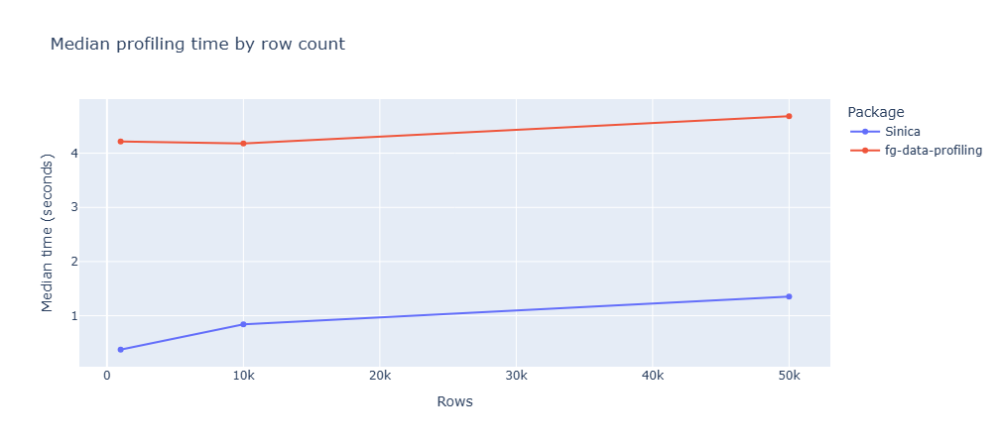

# Sinica 

[](https://badge.fury.io/py/sinica)
[](https://opensource.org/licenses/MIT)
[](https://www.python.org/downloads/)

**Sinica** is a lightweight Python data profiling tool built on `polars`, with optional `pandas` DataFrame input support. It provides statistical summaries, automated data quality alerts, and column-level analysis.

---

##  Key Features

- **Instant Statistical Summaries**: Get detailed, column-level statistical insights (mean, median, mode, missing values, min/max) in a single method call.
- **Automated Quality Alerts**: Detect data hygiene issues automatically, including:
  - Constant or zero-filled columns
  - High correlation between features
  - High cardinality & severe class imbalance
  - Skewed distributions & missing data percentages
  - Duplicate rows & empty dataset checks
- ⚡ **Polars-powered**: Returns `polars.DataFrame` summaries and alerts, while accepting `polars.DataFrame`, `polars.LazyFrame`, and (with the `pandas` extra installed) `pandas.DataFrame` inputs.

---

##  Installation

Install `sinica` directly from PyPI using `pip`:

```bash
pip install sinica
```

To enable input conversion from pandas DataFrames, install the optional extra:

```bash
pip install "sinica[pandas]"
```

#  Quick Start

Here is how you can profile a dataset in under 10 seconds:
```python
import pandas as pd
from sinica.core import ProfileReport

# 1. Load your DataFrame
df = your_data_frame

# 2. Instantiate the ProfileReport
pr = ProfileReport(df)

# 3. Simply run
pr.show_overview()

# 4. Generate a statistical summary
pr.get_summary()

# 5. Extract data quality alerts
pr.get_alerts()
```

## Column-level analysis

Use `ProfileReport.univ` to display detailed statistics and plots for a column.
Pass an explicit type: `"numeric"`, `"text"`, `"date"`, or `"categorical"`.
Aliases such as `"num"`, `"str"`, `"datetime"`, and `"category"` are also accepted.

```python
pr.univ("age", "numeric")
pr.univ("comment", "text")
```

## Performance comparison

The chart below compares median profiling times for Sinica and `fg-data-profiling` across the row counts shown. For Sinica, the benchmark includes summary and alert generation plus univariate analysis of every column. The tools perform different analyses, so these timings are an indicative end-to-end comparison rather than a feature-for-feature benchmark. Results vary with hardware, data, package versions, and configuration.


